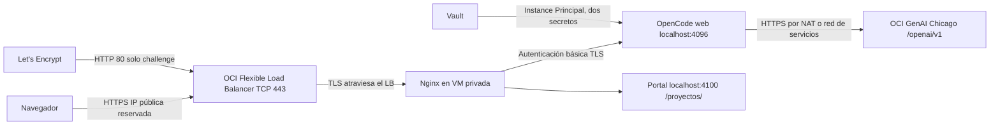

# Reversa en OCI

Instalación repetible en un tenant limpio. Infraestructura Terraform y bootstrap
incluidos. VM privada, balanceador público con IP reservada, HTTPS gratuito para
la IP y OpenCode conectado directamente a OCI Generative AI. Sin LiteLLM.

**Estado de esta entrega:** código validado localmente; consultar
[registro del despliegue](docs/deployment-status.md) para saber qué existe realmente
en OCI. Un `terraform apply` correcto no acredita que la aplicación funcione.

## Arquitectura



TLS termina en Nginx dentro de la VM: evita copiar una clave privada nueva al LB
cada pocos días. El LB es de capa TCP y admite WebSocket/SSE. Puerto 80 publica
solo `/.well-known/acme-challenge/` y `/healthz`; el resto devuelve 404. La app,
proyectos y resultados exigen usuario y contraseña sobre HTTPS. Sin SSH público.

Los compartimentos son `reversa`, y dentro `reversa-network`, `reversa-app`,
`reversa-security`, `reversa-ai`, `reversa-operations`. El identity domain no se
recrea y su OCID no se usa como tenancy OCID. El stack crea Vault DEFAULT con clave
SOFTWARE, VCN, NAT/Internet/Service Gateways, rutas, NSG, LB e IP reservada.

## Despliegue en otro tenant

Requisitos: permisos de administración de los recursos descritos, Terraform
1.5+ (1.14.0 usado localmente), Python 3.11+, SDK OCI 2.191.0 y una sesión OCI
autenticada. Se necesita Chicago o una región donde el modelo elegido esté
disponible. Configurar `home_region` según el tenant, no asumir que coincide.

Para ejecutar ambas fases de forma seguida, tras completar `tenant.tfvars` e
instalar el SDK OCI en un venv:

```bash
python3 scripts/deploy.py --vars tenant.tfvars --apply
```

Usa una sesión OCI existente. Selecciona automáticamente una imagen Ubuntu 24.04
compatible con E5 y la primera AD; la capacidad real se comprueba al crear la VM.
La opción `--profile PERFIL --auth security_token` permite reutilizar una sesión
temporal. Este comando administra su propio estado local y no se debe ejecutar
contra recursos ya administrados por otro estado o Resource Manager.

1. Clonar este repositorio y copiar `tenant.example.tfvars` a
   `tenant.tfvars`, completando tenancy y home region.
2. Crear el paquete y validar:

   ```bash
   python3 scripts/package.py
   terraform init
   terraform validate
   terraform plan -var-file=tenant.tfvars -out=foundation.tfplan
   terraform apply foundation.tfplan
   mkdir -p local
   terraform output -json > local/outputs.json
   ```

   `enable_compute=false` crea la base completa **sin VM**. Conservar el estado;
   no ejecutar un segundo stack independiente contra esos mismos recursos.

3. Preparar credenciales de este tenant, directamente en Vault:

   ```bash
   python3 -m venv .venv
   . .venv/bin/activate
   pip install oci==2.191.0
   python3 scripts/prepare-runtime.py --outputs local/outputs.json
   ```

   Para perfil de sesión usar `--profile PERFIL --auth security_token`. El script
   crea la API key GenAI y contraseña aleatoria, las guarda en Vault y escribe
   únicamente OCIDs en `local/runtime.auto.tfvars.json`. Mantiene un checkpoint
   privado para reintentar sin crear otra clave. No copiar la carpeta `local/`.
   La API key expira a los 90 días; rotar sus dos claves alternadamente y actualizar
   el secreto Vault antes del vencimiento. No hay renovación automática de esa
   credencial en esta entrega. El certificado HTTPS sí se renueva automáticamente.

4. Aplicar primero permisos y esperar propagación IAM:

   ```bash
   terraform apply -var-file=tenant.tfvars -var-file=local/runtime.auto.tfvars.json
   ```

5. El script selecciona una imagen **Ubuntu 24.04 x86_64** compatible con
   `VM.Standard.E5.Flex` y una AD y las guarda en el JSON local. Revisarlas antes
   del Plan. Para otra shape, seleccionar imagen/AD compatibles explícitamente.
   No reutilizar OCIDs de otro tenant o región. Si se necesita administración SSH,
   configurar una IP /32 en
   `bastion_allowed_cidrs` y una clave pública propia: se crea OCI Bastion con
   sesiones temporales, no una VM bastión pública.

6. Habilitar la VM sobre el mismo estado:

   ```bash
   terraform plan -var-file=tenant.tfvars -var-file=local/runtime.auto.tfvars.json \
     -var=enable_compute=true -out=application.tfplan
   terraform apply application.tfplan
   terraform output url
   ```

   Arranca con cloud-init. Instala Reversa 1.3.4, OpenCode 1.19.0, portal y servicios.
   La referencia histórica se conserva; cualquier actualización debe probarse por
   separado. Los paquetes del SO se resuelven con actualizaciones de Ubuntu; esto
   es repetibilidad de configuración, no una imagen binariamente inmutable.

7. Leer las credenciales web desde Vault con la identidad administradora. No
   pegarlas en GitHub, logs o chats. Verificar los pasos de
   [aceptación](docs/operations.md) antes de dar la instalación por terminada.

## OCI Resource Manager

`python3 scripts/package.py` genera `reversa-resource-manager.zip`, con los `.tf`,
la plantilla cloud-init, el runtime y el lock de proveedores. Crear stack desde
ZIP en Resource Manager; definir `tenancy_ocid`, `home_region`, `region` y dejar
`enable_compute=false`. Ejecutar Plan y después Apply.

El stack puede guardarse en el compartimento raíz, para existir antes de los
compartimentos que crea. Resource Manager conserva y bloquea el estado. Descargar
las salidas JSON del job para el script de credenciales. Después actualizar las
variables del **mismo stack** con los OCIDs generados, aplicar IAM con compute
desactivado y finalmente habilitarlo con imagen/AD verificadas.

No alternar Terraform local y Resource Manager con estados separados. Para migrar
entre ellos, transferir/importar el estado de forma explícita antes de aplicar.

## Parámetros y operación

Consultar `variables.tf`, [operación y recuperación](docs/operations.md),
[decisiones e historia](docs/history.md) y [fuentes oficiales](docs/sources.md).
El portal permite crear proyectos, subir ZIP, consultar Markdown/resultados y
abrir sitios HTML generados. No publica automáticamente carpetas fuera del portal.

Reversa se instala por proyecto usando sus módulos oficiales de la base 1.3.4.
No se copian estados, análisis, reglas experimentales, callbacks, guardias o
sesiones de la instalación anterior. La inicialización no certifica un análisis:
activar `/reversa` en una conversación nueva del proyecto y comprobar entregables.

La configuración fija proveedor `oci`, ID real de Grok y endpoint Oracle directo.
Los límites de contexto/salida son parámetros y deben contrastarse con el modelo.
Los 429 por cuota permanecen; el stack no aumenta cuotas ni crea clusters dedicados.

El despliegue tiene una VM: no ofrece alta disponibilidad de aplicación. Los
volúmenes preservados requieren política de backups y prueba de restauración.
LB, VM, NAT, almacenamiento e inferencias pueden generar cargos OCI; HTTPS gratuito
no equivale a infraestructura gratuita. Eliminar el stack detiene el servicio:
los compartimentos usan `enable_delete=false` y el volumen de arranque se preserva.
Un teardown completo exige inventario y decisión sobre datos/certificados/IP.

Licencia MIT heredada de Reversa y del código de integración incluido. Ver LICENSE.
