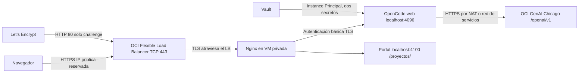

# Arquitectura y componentes

[Inicio](../README.md) · Referencia técnica, no es una guía de ejecución.

## Diagrama

TLS termina en Nginx dentro de la VM: evita copiar una clave privada nueva al LB
cada pocos días. El LB es de capa TCP y admite WebSocket/SSE. Puerto 80 publica
solo `/.well-known/acme-challenge/` y `/healthz`; el resto devuelve 404. La app,
proyectos y resultados exigen usuario y contraseña sobre HTTPS. Sin SSH público.

Los compartimentos son `reversa`, y dentro `reversa-network`, `reversa-app`,
`reversa-security`, `reversa-ai`, `reversa-operations`. El identity domain no se
recrea y su OCID no se usa como tenancy OCID. El stack crea Vault DEFAULT con clave
SOFTWARE, VCN, NAT/Internet/Service Gateways, rutas, NSG, LB e IP reservada.

## Versiones de la base

Ubuntu 24.04, Reversa 1.3.4, OpenCode 1.19.0, Certbot 5.4.0.
La VM usa VM.Standard.E5.Flex, 2 OCPU, 16 GB y boot volume de 100 GB por defecto.
Los parámetros están en [variables.tf](../variables.tf). Una actualización de
Reversa requiere ajustar también el inicializador y validar los proyectos.

## Alcance

Un único servidor de aplicación, sin alta disponibilidad. El boot volume se
preserva, pero no hay backup independiente configurado. La clave GenAI vence
a los 90 días y su rotación es manual. El certificado IP se comprueba cada seis
horas. No se configuró un destino de alertas. Los 429 dependen de cuotas del
modelo. Los OCID y secretos son propios de cada tenant.
